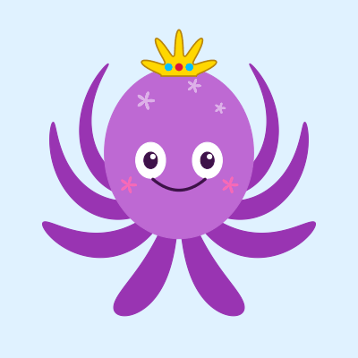

# 玫瑰線章魚小怪獸 2.0

TAICA 生成式 AI 第一週作業「在 Colab 中畫一個函數圖形」的補交版（第十一週補交）。
成大 F74146115 資訊118 謝承祐

用玫瑰線 r = a·cos(kθ) 拼出章魚小怪獸，並延伸出新表情、配件、色相滑桿、游泳動畫和海底場景。

## 檔案

| 檔案 | 說明 |
|---|---|
| `TAICA_HW1_rose_octopus_v2.ipynb` | 程式檔（已執行，含輸出） |
| `octopus_swim.gif` | 游泳動畫 |
| `screenshots/` | 繳交用重點截圖 |

本作業使用生成式 AI（Claude）協同製作，詳見 notebook 最後的 AI 使用說明。
